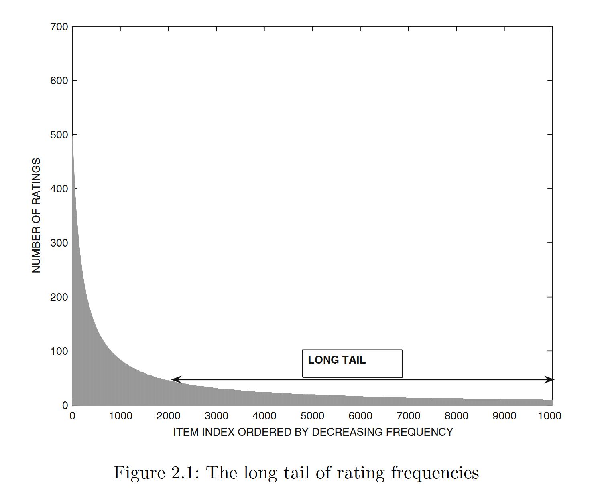

# Recommender Systems: The Textbook

**TABLE OF CONTENTS**:

1. [An Introduction to Recommender Systems](#chapter-1-an-introduction-to-recommender-systems)
    - 1.1 [Introduction](#11-introduction)
    - 1.2 [Goals of Recommender Systems](#12-goals-of-recommender-systems)
    - 1.3 [Basic Models of Recommender Systems](#13-basic-models-of-recommender-systems)
    - 1.4 [Domain-specific Challenges in Recommender Systems](#14-domain-specific-challenges-in-recommender-systems)
    - 1.5 [Advanced Topics and Applications](#15-advanced-topics-and-applications)
2. [Neighborhood-Based Collaborative Filtering](#chapter-2-neighborhood-based-collaborative-filtering)
    - 2.1 [Introduction](#21-introduction)
    - 2.2 [Key Propoerties of Ratings Matrices](#22-key-properties-of-ratings-matrices)
    - 2.3 [Predicting Ratings with Neighborhood-Based Methods](#23-predicting-ratings-with-neighborhood-based-methods)

---

## Chapter 1: An Introduction to Recommender Systems

### 1.1 Introduction

**User**: entity to which the recommendation is provided.

**Item**: product being recommended.

**Knowledge-based recommender systems**: recommendations are based on *user*-specified requirements rather than history.

**Collaborative filtering**: using ratings from multiple users in a *collaborative* way to predict missing ratings.

**Content-based recommender systems**: users' ratings and attribute descriptions are leveraged to make predictions.

### 1.2 Goals of Recommender Systems

**Recommendation problem**:
- Prediction version of problem:
    - Predicts rating for user-item combination. Assumes training data is available.
    - For $m$ users and $n$ items, corresponds to an incomplete $m \times n$ matrix.
    - Also referred to as *matrix completion problem*.
- Ranking version of problem:
    - Recommends the top-$k$ items for a particular user (or less commonly  the top-$k$ users to target with an item).
    - Also referred to as *top-$k$ recommendation problem*.

**Common operational and technical goals**:
1. <u>Relevance</u>: recommending items which are relevant to the users.
2. <u>Novelty</u>: recommending items the user has not seen in the past.
3. <u>Serendipity</u>: recommending items which are somewhat unexected, coming across as a "lucky discovery".
4. <u>Increasing recommendation diversity</u>: avoid recommending items which are too similar.

**Commercial recommender systems**:
- GroupLens Recommender System
- Amazon.com Recommender System
- Netflix Movie Recommender System
- Google News Personalization System
- Facebook Friend Recommendations

### 1.3 Basic Models of Recommender Systems

#### 1.3.1 Collaborative Filtering Models

Use ratings provided by multiple users to make recommendations.

The main challenge is that ratings matrices are *sparse*.
- Specified ratings are also known as *observed ratings*.

Most models use either inter-item correlation or inter-user correlation. Some use both.

**Types of models to impute missing values**:

1. <u>Memory-based methods</u>: also referred to as *neighborhood-based collaborative filtering algorithms*. AMong the earliest collaborative filtering algorithms. Ratings of user-item combinations are predicted based on their neighborhoods.
    - **Approaches**:
        - *User-based collaborative filtering*: determine users who are similar to a target user $A$; infer values for unobserved ratings of $A$ by computing weighted averages of the ratings of the similar users.
        - *Item-based collaborative filtering*: determine set of items $S$ which are most similar to target item $B$; the ratings of $S$ by user $A$ are used to predict whether $A$ will like item $B$.
    - **Pros**: Techniques are simple to implement, recommendations are easy to explain.
    - **Cons**: Do not work well with sparse matrices.
2. <u>Model-based methods</u>: machine learning and data mining models are used to make predictions; if models are parameterized, parameters are learned using optimization.
    - **Examples**: decision trees, rule-based models, Bayesian methods, [latent factor models](https://rafalab.dfci.harvard.edu/dsbook-part-2/highdim/latent-factor-models.html).

**Types of ratings**:

*Interval-based ratings*: a discrete set of ordered numbers is used to quantify like or dislike.

*Forced choice rating system*: system in which a neutral rating is missing.

*Ordinal ratings*: a discrete set of ordered categorical values to express like or dislike.

*Binary ratings*: users indicate only a like or dislike for the item.
- *Unary ratings*: special case, in which the user can specify a liking for an item but not a dislike; particularly common in [implicit feedback data sets](https://ieeexplore.ieee.org/document/4781121).

> NOTE: "Pre-substitution of missing ratings is not recommended in explicit ratings matrices. In explicit ratings matrices with both likes and dislikes, the substitution of missing entries with any value (such as a $0$ or the row/column/data mean) always leads to a significant amount of bias in the analysis." (p. 12)

**Collaborative filtering** can be seen as a special case of [missing value analysis](https://bookdown.org/drki_musa/dataanalysis/introduction-to-missing-data-analysis.html) in which the data matrix is very large and sparse.

**Collaborative filtering** can also be seen as a generalization of classification and regression modeling, in which any column is allowed to have missing values, instead of only the class (target) variable.

#### 1.3.2 Content-based Recommender Systems

Use descriptive attributes of items to make recommendations.

Ratings and the users' buying behavior are combined with content information avaiable on the items (e.g., for a movie, it could be its description).

Here, the descriptions of the items are labeled with ratings and used as training data to create a *user-specific* classification or regression model.

**Advantage**: making recommendations for new items, with insufficient ratings data.

**Disadvantages**:
- They might make obvious recommendations, avoiding items with a a set of keywords the user never consumed (which means the recommndations might lack diversity).
- They are not effective in providing recommendations for new *users*, since the training models require to leverage said user's past ratings.

#### 1.3.3 Knowledge-based Recommender Systems

Particularly useful when items are not consumed or purchased very often, thus sufficient ratings may not be available.

Ratings are not used for recommendations, but rather the similarity between customer requirements and item descriptions.

Facilitated by the use of *knowledge bases*, with data about rules and similarity functions to use during retrieval.

Provide user with more control over the recommendation process, due to the explicit specification of requirements (in contrast with collaborative filtering and content-based systems, which basically rely on the users' past actions).

**Types of interface (and corresponding knowledge)**:

1. <u>Constraint-based recommender systems</u>: user typically specify requirements or constraints (e.g., lower or upper limits) on items' attributes. Domain-specific rules are used to match the user requirements to item attributes. 
2. <u>Case-based recommender systems</u>: users specify targets or anchor points. Similarity metrics are defined on the item attributes to retrieve similar items to these cases.

**Methods of interactivity**:
1. <u>Conversational systems</u>: user preferences are determined iteratively, in a feedback loop.
2. <u>Search-based systems</u>: user preferences are defined by using a preset sequence of questions.
3. <u>Navigation-based systems</u>: the user specifies a number of change requests to the item being currently recommended, until they arrive at a desirable item.

**Utility-based Recommender Systems**:

A utility function is defined on the item features to compute the probability of a user liking it.
- Can be viewed as a special case of knowledge-based recommender systems, in which the values of the utility function are known *a priori*.

#### 1.3.4 Demographic Recommender Systems

Demographic information about the user is used to model ratings or buying propensities.

*Context-sensitive recommender systems*: demographic information is combined with additional context to guide recommendation.

Do not usually provide the best results in and of themselves, but can increase the power of other recommender systems as a part of hybrid or ensemble models.

#### 1.3.5 Hybrid and Ensemble-Based Recommender Systems

Particularly useful when there is a variety of inputs available.

Closely related to the field of [ensemble analysis](https://en.wikipedia.org/wiki/Ensemble_learning).

#### 1.3.6 Evaluation of Recommender Systems

Many of the models used for evaluation of classifiers can be used for evaluating recommender systems, but with some adjustments.

### 1.4 Domain-specific Challenges in Recommender Systems

#### 1.4.1 Context-based Recommender Systems

Take various types of contextual information into account when making recommendations, including time, location, and social data.

It has been generally observed that using such contextual information can improve the effectiveness of recommendation.

#### 1.4.2 Time-sensitive Recommender Systems

**Temporal aspects in recommender systems**:

1. The rating of an item might evolve over time, following users' interests, likes, dislikes, and fashions.
    - Can be done by incorporating an explicit temporal parameter in a collaborative filtering system.
2. The rating of an item might change according with the time of the day, day of the week, month, or season.
    - Can be viewed as a special case of context-based recommender systems.

Temporal recommender systems usually worsen the rating matrix's sparsity problem.
- It is important to have large data sets in these settings. 

#### 1.4.3 Location-based Recommender Systems

**Spatial locality common to recommender systems**:

1. User-specific locality (or *preference* locality): the user's geographical location influences their preferences.
    - Algorithms are similar to context-sensitive systems.
2. Item-specific locality (or *travel* locality): the item's geographical location influences its relevance to the user.
    - Algorithms usually designed as *ad hoc* heuristics.

#### 1.4.4 Social Recommender Systems

**Structural Recommendation of Nodes and Links**:

Problem of node recommendation is closely related to that of Web search:
- Both require ranking algorithms, which are also referred to as personalized [PageRank](https://en.wikipedia.org/wiki/PageRank) algorithms.
- *Collective classification*: when examples of nodes of interest are available and are used as training data to determine other possible nodes of interest.
- Link recommendation or link prediction problem is also closely related.

**Product or Content Recommendations with Social Influence**:

*Viral marketing*: recommendation of products and content based on network connections and other social cues.
- To achieve the goal it is important to identify influential entities in the network: *influence analysis*.

**Trustworthy Recommender Systems**:

There are websites that allow users to express their trust or distrust in one another.
- Research has shown that incorporating trust information leads to better recommendations.

**Leveraging Social Tagging Feedback for Recommendations**:

*Tags*: metadata users utilize to add short informative keywords to a content.
- Tags are useful content for recommendations.
- Context-sensitive recommendation can directly incorporate such feedback.

### 1.5 Advanced Topics and Applications

#### 1.5.1 The Cold-Start Problem in Recommender Systems

**Cold-start problem**: number of initially available ratings is small.
- It is difficult to apply collaborative filtering.
- Content-based and knowledge-based methods are more robust than collaborative filtering, but the information theyr require might not also be available.

#### 1.5.2 Attack-Resistant Recommender Systems

Sellers of products and services have significant economic incentives to manipulate the output of recommender systems (e.g., inflating ratings).
- We need methods to have robust recommendations in the presence of such attacks.

#### 1.5.3 Group Recommender Systems

*Group recommender systems*: tailored to make recommendations to a group of user, rather than a single one.
- Consensus has evolved such that taking interactions between users into account, in some settings, might yield better results than making individual recommendations.
- This happens because users might impact each others' tastes and preferences.

#### 1.5.4 Multi-Criteria Recommender Systems

In multi-criteria systems, the user might rate items on different dimensions.
- For instance, a movie can be rated based on the plot, music, special effects etc.
- Techniques involve modeling the user's utility for a certain item as a vector of ratings corresponding to the criteria.

#### 1.5.5 Active Learning in Recommender Systems

To overcome the sparsity of the ratings matrix, some systems have mechanisms to encourage users to provide ratings to populate the system.

#### 1.5.6 Privacy in Recommender Systems

Privacy concerns might impede the release of data that is necessary for advancing recommendation algorithms.

#### 1.5.7 Application Domains

Some domains in which recommender systems are applied require specialized methods.
- For instance, recommender systems assume the existence of a strong user-identification mechanism, which, say, in Web settings, might ont be available.

## Chapter 2: Neighborhood-Based Collaborative Filtering

### 2.1 Introduction

Neighborhood-based collaborative filtering is also known as memory-based algorithms.

**Types**:
- *User-based collaborative filtering*: ratings provided by similar users to a target user $A$ are used to make recommendations for $A$.
- *Item-based collaborative filtering*: the rating of a particular user $A$ for an item $B$ is computed from the weighted average rating of a set $S$ of items most similar to $B$.

Let the *user-item matrix* be an incomplete $m \times n$ matrix $R = [r_{uj}]$, containing $m$ users and $n$ items.

Neighborhood-based collaborative filtering (as all collaborative filtering algorithms) can be formulated in two ways:
1. *Predicting the rating value of a user-item combination*: i.e., predicting $r_{uj}$.
2. *Determining the top $k$ items or top $k$ users*: when it is more relevant to learn the most relevant items for an user, or the top $k$ users for which an particular item might be relevant.

### 2.2 Key Properties of Ratings Matrices

Ratings matrix: $m \times n$ matrix $R = [r_{uj}]$
- *Training data*: specified entries of matrix $R$;
- *Test data*: unspecified entries.

**Ratings definitions**:
1. *Continuos ratings*: specified on a continuous scale; the drawback is that the user has to think of a real value from an infinity of possibilities.
2. *Interval-based ratings*: drawn most commonly from a 5-point or 7-point scale; assumes numerical values explicitly define distances between ratings; ratings are usually equidistant.
3. *Ordinal ratings*: similar to interval-based ones, except that ordered *categorical* values are used; does not assume the differences between adjacent pairs of ratings are the same; generally, the number of positive and negative ratings is balanced, to avoid bias.
4. *Binary ratings*: only two options present, corresponding to positive and negative feedback; can be viewed as a special case of interval-based or ordered ratings.
5. *Unary ratings*: allow user to specify positive preference for items, without a mechanism for negative preference; more often derived from users' actions, such as clicking the "like" button or purchasing an item.
    - Derivation: implicit feedback, see also [Positive Unlabeled Learning](https://www.geeksforgeeks.org/machine-learning/why-positive-unlabeled-learning/).

**Long-tail property**:
- Only a small fraction of items are rated frequently (*popular* items); vast majority are rated rarely. Thus, underlying ratings follow a highly skewed distribution.
- Implications:
    1. Commonly, high-frequency items are competitive with little profit margin, while lower frequency ones are more profitable. In these cases, it is more advantageous to recommend lower frequency items.
    2. Due to the rarity of ratings for long tail items, it is more difficult to provide robust predictions for them. This might affect the recommendations' *diversity*.
    3. Frequently rated items are fewer in number. For algorithms such as neighborhood-based collaborative filtering, those few frequently-rated observations will be the basis for predictions, even though they might not be representative of the low-frequency items.

### 2.3 Predicting Ratings with Neighborhood-Based Methods

**Basic principles in neighborhood-based models**:
1. User-based models: similar users have similar ratings on the same item.
2. Item-based models: similar items are rated in a similar way by the same user.

#### 2.3.1 User-Based Neighborhood Models

To determine the neighborhood of target user $i$, we compute their similarity to all other users.

Let $R = [r_{uj}]$ be the $m \times n$ ratings matrix, with $m$ users and $n$ items. Let $I_u$ be the set of item indices for which user (row) $u$ specified ratings.
- Therefore, the set of items rated by both users $u$ and $v$ is given by $I_u \cap I_v$. These are the mutually observed ratings, used to compute the similarity between $u$ and $v$ $\text{Sim}(u,v)$. 

**Pearson correlation coefficient**: one measure that captures the similarity $\text{Sim}(u,v)$. (More at [Pearson Correlation Coefficient](https://en.wikipedia.org/wiki/Pearson_correlation_coefficient).)

First step: mean rating $\mu_{u}$ for each user $u$. 

$$
\mu_{u} = \displaystyle\frac{\sum_{k \in I_u} r_{uk}}{|I_u|} \quad \forall u \in \{1, ..., m\}
$$

Coefficient between rows (users) $u$ and $v$.

$$
\text{Sim}(u,v) = \text{Pearson}(u,v) = \displaystyle\frac
{\sum_{k \in I_u \cap I_v} (r_{uk} - \mu_{u})\cdot(r_{vk} - \mu_v)}
{\sqrt{\sum_{k \in I_u \cap I_v} (r_{uk} - \mu_u)^2} \cdot \sqrt{\sum_{k \in I_u \cap I_v} (r_{vk} - \mu_v)^2}}
$$

> "The Pearson coefficient is computed between the target user and all the other users. One way of defining the peer group of the target user would be to use the set of $k$ users with the highest Pearson coefficient with the target. However, since the number of observed ratings in the top $k$ peer group of a target user may vary significantly with the item at hand, the closest $k$ users are found for the target user separately for each predicted item, such that each of these k users have specified ratings for that item. The weighted average of these ratings can be returned as the predicted rating for that item. Here, each rating is weighted with the Pearson correlation coefficient of its owner to the target user." (p. 35)

Main problem with this approach: different rating scales.
- Raw ratings need to be mean-centered in a row-wise way before the neighborhood's weighted average is determined.
- The mean-centered rating $s_{uj}$ of a user $u$ for item $j$ is computed by subtracting the mean rating $\mu_{u}$ from the raw rating $r_{uj}$:

$$
s_{uj} = r_{uj} - \mu_{u}
$$

(PG 36)

#### 2.3.2 Item-Based Neighborhood Models